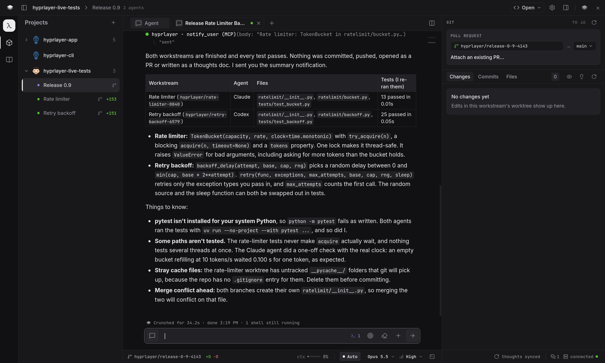

<p align="center">
  
</p>

<h1 align="center">Hyprlayer</h1>

<p align="center">
  <strong>Orchestrate your coding agents. Or let them do it.</strong><br />
  A desktop app for running Claude Code, Codex, and OpenCode side by side.
</p>

<p align="center">
  <a href="https://hyprlayer.dev">Website</a> ·
  <a href="https://hyprlayer.dev/desktop/install">Install</a> ·
  <a href="https://hyprlayer.dev/cli/getting-started/installation">Docs</a> ·
  <a href="https://github.com/BrightBlock/hyprlayer-app/releases">Changelog</a> ·
  <a href="https://discord.gg/QFyX2FVkZM">Discord</a>
</p>



## Install

It's free and uses the Claude Code, Codex, and OpenCode logins you already have.
Every build is on the
[latest release](https://github.com/BrightBlock/hyprlayer-app/releases/latest).

### macOS (Apple Silicon)

```sh
brew install --cask brightblock/tap/hyprlayer-desktop
```

Or download the `.dmg` from the latest release.

### Windows (x64)

Download the `-setup.exe` installer from the latest release and run it. It
isn't code-signed yet, so SmartScreen warns: choose **More info → Run anyway**.

### Arch Linux (x86_64)

```sh
yay -S hyprlayer-desktop-bin    # or: paru -S hyprlayer-desktop-bin
```

### Debian and Ubuntu (x86_64)

Download `Hyprlayer_<version>_amd64.deb` from the latest release, then:

```sh
sudo apt install ./Hyprlayer_<version>_amd64.deb
```

Use `apt` rather than `dpkg -i` so the dependencies resolve.

### Fedora, RHEL, and openSUSE (x86_64)

Download `Hyprlayer-<version>-1.x86_64.rpm` from the latest release, then:

```sh
sudo dnf install ./Hyprlayer-<version>-1.x86_64.rpm      # Fedora, RHEL
sudo zypper install ./Hyprlayer-<version>-1.x86_64.rpm   # openSUSE
```

The Linux packages need a recent glibc: Ubuntu 24.04, Debian 13, Fedora 40, or
newer.

### The CLI (optional)

Install the [hyprlayer CLI](https://hyprlayer.dev/cli/getting-started/installation)
if you want the same workflow's slash commands in your terminal.

```sh
brew install brightblock/tap/hyprlayer   # macOS
winget install BrightBlock.Hyprlayer     # Windows
yay -S hyprlayer-bin                     # Arch
```
