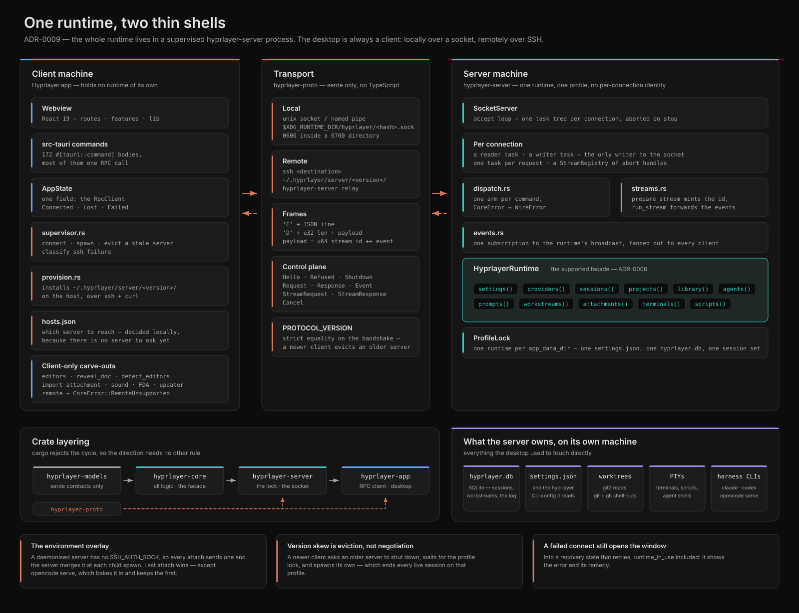
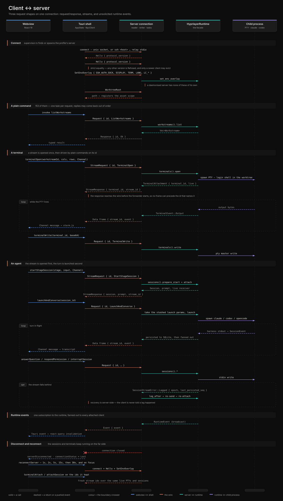
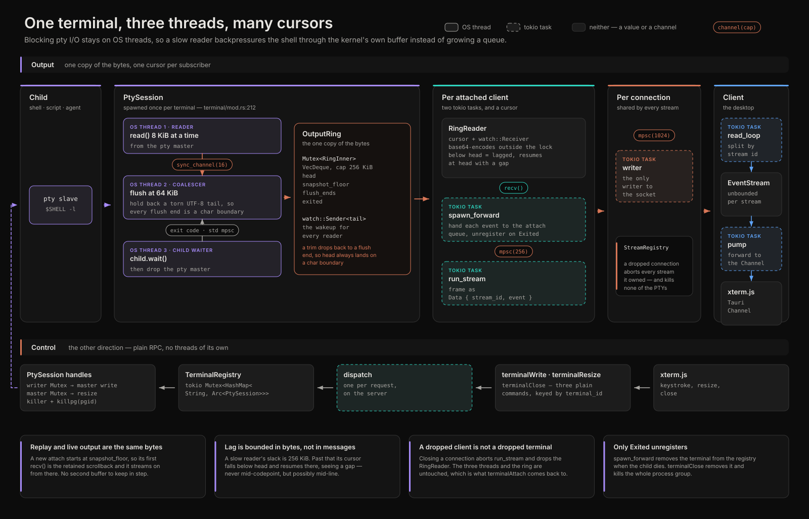

# Client and server: how the desktop talks to `hyprlayer-server`

A walkthrough of the architecture ADR-0009 decided, following each path end to
end: from a double-click to a live connection, then a plain command, a terminal,
an agent turn, an event, a dropped connection, and a remote host.

This document is the **how**. ADR-0009 is the **why** — it records what was
decided and what was deliberately not, and its phase changelogs say what each
phase moved. `rust-runtime-library.md` is the API reference for the facade
everything here bottoms out in. Where the two disagree about what exists, the
tree is right and this document follows the tree.

## The shape

The whole runtime — SQLite, settings, provider drivers, PTYs, git, the watchers —
lives in one supervised process, `hyprlayer-server`. The desktop holds none of
it. It is a client of that process whether the process is on the same machine
(a Unix socket, a named pipe on Windows) or on another one (`ssh <host>
… hyprlayer-server relay`). Sessions, terminals and scripts therefore outlive
the app: quitting is free, and updating is not.

**Open the SVG itself** — all three diagrams here are drawn at 1600 px wide and read poorly scaled into a column.

One server serves one profile: one `settings.json`, one `hyprlayer.db`, one
session set, held by `ProfileLock`. There is no per-connection identity anywhere
in the runtime — every attached client sees the same state and can act on all of
it. "Multi-client" means your laptop and your desktop attached to your server;
a second user means a second server on a second profile.

Authorization is the filesystem and SSH. The socket is 0600 inside a 0700
directory (`socket.rs`), and there is no network listener at all, which is what
makes "no authentication" safe rather than reckless.

The sequence below is the map for Parts 3 to 7; each part walks one of its bands.

## Part 1 — Starting up

### Deciding which server

`setup()` (`src-tauri/src/lib.rs`) reads `hosts.json` before it connects
anything. That file is the one decision that has to be made locally, because
there is no server to ask which server to reach. It lives in `app_config_dir`
rather than in `settings.json` — the desktop is its only reader and its only
writer, and a second shell-side writer to `settings.json` would break ADR-0002's
single-writer rule (`src-tauri/src/hosts.rs`).

No active host means the local profile; an active host means SSH, and a failure
there must never fall back to local. Connecting to the wrong profile's data is
the single most damaging mistake this design makes available.

### Finding or spawning a local server

`supervisor::connect_or_spawn` tries a connect first. Four outcomes:

- **It connects.** A server is already listening — the normal case, and the
  reason quitting the app is free.
- **`ENOENT` / `ECONNREFUSED`.** Nothing is listening. Check
  `.runtime-fatal.json` (below), then spawn `hyprlayer-server serve` as a
  deliberate orphan — `process_group(0)`, no `kill_on_drop`, `DETACHED_PROCESS`
  on Windows — and race `try_wait()` against repeated connects. A cold start
  opens SQLite and runs migrations, so the spawn path gets 300 retries where a
  reconnect gets 10.
- **Refused, and we are newer.** The eviction dance: a fresh low-level handshake
  that sends `Shutdown` right after the peer's `Hello`, a poll for the socket to
  disappear, then spawn and connect.
- **Refused, and we are older.** No self-upgrade path exists, so this is a
  dialog: stop the server, or update this client.

A server not started by the desktop (systemd, launchd, by hand) has no stderr
the desktop can read, so a fatal `open` writes an `AppError`-shaped report to
`<app_data_dir>/.runtime-fatal.json` and the next successful `open` deletes it.
The desktop reads it only *after* its own spawn attempt exits, and only if it
was written since that spawn — reading it earlier wedges every later launch on a
stale report, because the one process that clears the file is a server that
opened successfully, and that one was never started.

### The handshake

Strict equality, both ways, and the server speaks first (`serve_connection`,
`crates/hyprlayer-server/src/lib.rs`):

1. Server sends `Hello { protocol_version }`.
2. Client sends its own `Hello`.
3. A mismatch gets `Refused { error }` and the connection ends — except when the
   peer is strictly *newer*, which earns one more read, honoured only if it is
   `Shutdown`. An equal-or-older peer's `Shutdown` is ignored, or two mismatched
   clients could evict each other in a loop.

`WireError::version_mismatch(ours, theirs)` attaches its remedy only when
`ours < theirs`, so it reads correctly from whichever side computes it — the
client never actually reads the server's `Refused` frame, because
`RpcClient::connect` has already returned on its own check of the peer's `Hello`.

`PROTOCOL_VERSION` is 1 and stays there until the first release that ships
`hyprlayer-server`. Nothing has ever shipped at any version, so wire changes
before that release are free; from that release onward it bumps on every
wire-affecting change.

### What a fresh connection is told

`attach_client` (`src-tauri/src/lib.rs`) runs on launch and again after every
reconnect:

- **`SetEnvOverlay`** — `SSH_AUTH_SOCK`, `DISPLAY`, `TERM`, `LANG` and every
  `LC_*` from the desktop's own environment. A daemonised server has none of
  these, so without this every `git push` and every `gh` call fails exactly the
  way ADR-0005 exists to prevent. The server merges the overlay over
  `process_env` at each child spawn — terminals, harness drivers, lifecycle and
  Run scripts, and every `git`/`gh` shell-out. The server merges per key, drops
  an `SSH_AUTH_SOCK` that is not a socket on its host, and a remote client sends
  no `SSH_AUTH_SOCK` or `DISPLAY`.
- **`AnnounceClient`** — the client id, device name and the targeted event
  kinds this build decodes (`SessionRevised`, `SessionReset`, `SessionViewers`,
  `AccountChanged`). Display-only (ADR-0009): it attributes user turns and
  grants nothing. A server that answers `unsupported_command` predates
  transcript sync.
- **`WatchSessions`** — the sessions the client views and the rev each last
  applied, re-sent as that set changes and on a poll. It replaces the
  connection's watched set and answers each session's `rev`, `reset_rev`,
  `working`, `in_flight` and `viewers`.
- **`WorktreeRoot`** — read once, to register the asset-protocol scope. This
  one does *not* repeat on reconnect: it derives from the host, and an unchanged
  host has an unchanged root.
- **The event bridge** — `runtime_events::spawn` takes the client's one-shot
  event receiver and maps each `RuntimeEvent` onto its Tauri event. One bridge
  per client, retiring with it.

Window focus feeds `set_foreground`, which drives the PR watcher's cadence. It
reads the live client each time rather than capturing one, because a reconnect
swaps it and a captured clone would leave the watcher stale with no error
anywhere.

### When it fails

The window opens anyway, into a recovery state — VS Code Remote-SSH's rule.
`AppState::failed` stores the named reason, every command answers with it rather
than a generic one, and `connectionStatus` reports it. The single exception is
`runtime_in_use`: another Hyprlayer already holds this profile's lock, which is
`tauri-plugin-single-instance`'s job rather than a connection to recover from,
and that arm still shows a dialog and exits.

One more downgrade happens after a successful handshake: if the very first
request (`WorktreeRoot`) comes back `server_disconnected`, the server is a build
this client cannot talk to. That becomes `Failed` with
`supervisor::incompatible_server_detail()` rather than an exit.

## Part 2 — The wire

### Two planes on one connection

`hyprlayer-proto` is serde-only — no Tokio, no Tauri, nothing that reaches
TypeScript. It defines a frame as a one-byte tag plus a body
(`crates/hyprlayer-proto/src/frame.rs`):

| Tag | Body | Carries |
|---|---|---|
| `C` | one JSON line, newline-terminated | the control plane |
| `D` | `u32` little-endian length, then bytes | the data plane |

A data frame's payload is an 8-byte little-endian stream id followed by the
encoded event (`encode_stream_frame`). One data plane serves every open stream
on the connection; that sub-framing is what tells them apart. `Decoder` is
incremental and remembers how far it has scanned, so a partially delivered
control line is not rescanned from its first byte on every feed.

The async I/O wraps the codec on the server side (`transport.rs`), never in
proto.

### Request and response

`ControlFrame` has nine variants: `Hello`, `Refused`, `Request`, `Response`,
`StreamRequest`, `StreamResponse`, `Event`, `Cancel`, `Shutdown`. It is
externally tagged so a large body deserializes straight into its type rather
than through serde's buffered `Content`.

The 159 plain commands are one table — `crates/hyprlayer-server/src/rpc.rs` —
expanded by `hyprlayer_proto::commands!` into three things at once: the
`Request`/`Response` enums, the server's `Dispatch` trait, and the typed methods
on `RpcClient`. Adding a command is one line in that table plus its `Dispatch`
arm.

The table lives in `rpc.rs` and not in proto because its types are core's
(`Session`, `Vec<Workstream>`, `Stage`) and proto cannot depend on core. That
constraint is also why the 11 streaming commands are declared in `streams.rs`.

Each request is answered by the `Response` carrying its id, and the server
spawns a task per request (`read_requests`), so replies may come back out of
order and a slow command never blocks the connection.

### Streams

A streaming command's response shape is a value *plus* a stream id, which is why
`StreamRequest`/`StreamResponse` are their own type-parameter pair rather than
variants of `Request`/`Response`: `read_requests` matches them before anything
reaches `dispatch()`, because a streaming command needs the connection's
outbound sender and its stream registry, which a plain `Dispatch` method never
sees.

The ordering rule is load-bearing and split across two functions
(`streams.rs`):

- `prepare_stream` does the work and mints the id, but starts no forwarding.
- The caller sends the response.
- `spawn_stream` only then starts the forwarder task.

Reverse those and a fast source can race a data frame ahead of the response that
explains its id. On the client side the same guarantee runs the other way:
`read_loop` registers the stream's receiver *before* the awaiting caller ever
sees the response, so no frame for a new stream can arrive before its consumer
does.

### Cancellation and teardown

Both directions of "stop" are explicit, because neither side can drop the
other's channel:

- **`cancel_stream(id)`** — the client stopped reading; the server aborts that
  forwarder. The wire equivalent of dropping a local receiver.
- **Dropping the connection** — `StreamRegistry::abort_all` aborts every stream
  it owned.
- **`Shutdown`** — asks the server to stop. It answers by closing the
  connection, so callers poll for the socket to disappear rather than wait for a
  reply.

None of the three kills a PTY or a harness process. That is the whole point.

## Part 3 — A plain command, end to end

`listWorkstreams`, from click to render:

1. **Webview.** `commands.listWorkstreams(projectPath, includeArchived)` from
   the generated `src/lib/bindings.ts`, wrapped in `unwrap()`
   (`src/lib/ipc.ts`), which throws the typed `AppError` on the error arm. Most
   callers reach it through a react-query hook in `src/lib/queries.ts`.
2. **Shell.** The `#[tauri::command]` body takes `state.client()?` — the live
   `RpcClient`, or a clone of the stored failure — and calls the generated
   `client.list_workstreams(...)`, mapping `WireError` into `AppError`.
3. **Client transport.** `RpcClient::call` allocates a request id, parks a
   `oneshot` sender in `pending`, encodes `Request { id, body }` as a control
   frame and queues it on the outbound channel. The writer task owns the socket.
4. **Server.** `read_requests` decodes the frame and spawns a task:
   `server.dispatch(body).await` into an `Outcome`, encoded back as
   `Response { id, outcome }` on the connection's one outbound queue. A result
   that fails to serialize becomes an error outcome rather than a dropped reply.
5. **Dispatch.** The arm (`dispatch.rs`) calls
   `runtime.workstreams().list(...)`, then does the composition the desktop used
   to do for itself: `effective_config_for` the project, a `status_batch` that
   checks each worktree's thoughts links, and `adopt_head_branches`. This runs
   against the *server's* filesystem, which is the entire reason it moved.
6. **Back.** `read_loop` matches the response id, fulfils the `oneshot`, and the
   awaiting `call` returns.

Nothing in that path is specific to `listWorkstreams`. The other 152 differ only
in their dispatch arm.

## Part 4 — A terminal, end to end

### Opening one

`terminalOpen(workstreamId, cols, rows, onEvent)` carries a Tauri `Channel`. The
shell turns it into `terminal_open_stream`, gets back
`(terminal_id, stream_id, EventStream<TerminalEvent>)`, and starts a pump that
forwards the stream into the channel.

Server side, `prepare_stream`'s `TerminalOpen` arm calls
`runtime.terminals().open(...)`, which looks the workstream up in SQLite, builds
an env vector of the augmented `PATH` plus the attach overlay, and spawns a
`PtySession` in the worktree with `default_shell()` and `-l`.

### Inside the `PtySession`

`PtySession::spawn` (`crates/hyprlayer-core/src/terminal/mod.rs:212`) starts
three OS threads and one ring:

- **Reader.** `read()` into an 8 KiB buffer, forever, into a
  `sync_channel(16)`. Bounded on purpose: blocking the reader stops it draining
  the pty, and the kernel's buffer then backpressures the shell. That is VS
  Code's `ptyProcess.pause()` without an ack protocol, because both ends are
  threads in one process. Unbounded, a `cat` of a large file outruns the
  coalescer and the queue grows without limit.
- **Coalescer.** Accumulates to 64 KiB, then pushes one flush into the ring —
  holding back a torn trailing codepoint until its continuation arrives, so
  every flush end, and therefore every replay start, is a character boundary.
- **Child waiter.** `child.wait()`, sends the exit code to the coalescer, drops
  the pty master.

`OutputRing` is the one copy of the bytes: a `VecDeque` capped at 256 KiB behind
a mutex, plus a `watch::Sender<tail>` that wakes readers. It keeps three
positions — `head` (moves only on trim), `snapshot_floor` (where a *new* attach
starts, raised by `clear_scrollback`, which must not move `head` because an
attached reader may still be below it), and `flush_ends` (at most one mark per
KiB, so a trim always lands `head` on a flush end).

### Out to the webview

Each attached client gets its own cursor, not its own copy:

1. **`RingReader`** — a cursor plus a `watch::Receiver`. `next_event` drains
   everything from the cursor to the tail under the lock, then base64-encodes
   *outside* it, so a slow reader never stalls the encoder. A cursor that has
   fallen below `head` resumes at `head` and the reader sees a gap.
2. **`spawn_forward`** (a Tokio task) hands each event to an `mpsc(256)` and
   removes the terminal from the registry on `Exited`.
3. **`run_stream`** (a Tokio task) frames each event as
   `Data { stream_id, event }`.
4. **The connection's `mpsc(1024)`** and its single writer task put it on the
   socket.
5. **Client.** `read_loop` splits frames by stream id into a per-stream
   unbounded channel; the pump forwards to the Tauri `Channel`; xterm.js writes
   it.

### Typing back

Keystrokes are not a stream. `terminalWrite(terminal_id, base64)` is a plain RPC
call, as are `terminalResize` and `terminalClose`. Server side they take the
registry's mutex to find the `Arc<PtySession>`, then the session's own writer or
master mutex. `terminalClose` removes the session and kills the whole process
group (`killpg`), not just the direct child.

### Detaching, reattaching, closing

Closing a connection aborts `run_stream` and drops the `RingReader`. The three
threads and the ring are untouched, so a relaunched client calls
`terminalAttach(terminal_id)` and gets a fresh stream over the same live shell,
starting with the retained scrollback. The scripts dock persists its terminal
list and backend ids for exactly this reason.

`Exited` is the only thing that unregisters a terminal on its own.

## Part 5 — An agent turn, end to end

### The stream opens before the turn runs

`startStageSession` is a stream request, and it does *not* launch anything.
`prepare_stream` finds the workstream, calls `sessions().prepare_start(...)`,
attaches to the session, stashes the prepared `LaunchAndConverseParams` in the
server's `StreamState` keyed by session id, and answers with
`{ session, prompt, stream_id }`. The parameters never leave the server process.

The webview then calls `launchAndConverse(session_id)` — a plain, fire-and-forget
RPC — which takes the stashed params and launches. Two calls rather than one, so
the client is already receiving the stream before the first token exists.

### What the driver produces

`launch_driver` (`runtime/sessions/service.rs`) spawns the harness — claude,
codex or opencode — through `spawn_driver`, records its pid as an orphan row,
registers the driver, and wires `spawn_relay` from the driver's receiver into
the session actor's ingress channel. Which guardrails the harness gets is
ADR-0007's business, not the transport's: `capability::launch_policy` lowers
`(harness, stage)` onto the primitive each one understands.

### The session actor

One actor per session (`runtime/sessions/forwarder.rs`), a `select!` loop over a
control channel and an `mpsc(2048)` ingress. For each event it:

1. Increments the delivery ordinal.
2. Decides whether the event is ephemeral (`PartialText`, an unreportable exit)
   or persisted — persisted events go to SQLite through
   `apply_session_event`, which also applies any row mutation the event implies.
3. Bumps `sessions.rev` for a committed `userMessage`/`assistantText`/
   `toolResult`/`rewound` and emits `SessionRevised`; a rewind or restore
   raises `reset_rev` and emits `SessionReset` instead. Both are targeted
   (Part 6).
4. Emits a `SessionLifecycle` runtime event when the event changes state
   (`Init` → `Running`, `PermissionAsk` → `AwaitingPermission`, and so on).
5. Fans the delivery out to every `LiveAttachment`, dropping the ones that have
   detached.

Persist-then-fan-out is the order that matters: the log is the durable record,
and the live stream is a view of it.

### Fan-out, and what happens when a reader is slow

Each attachment is an `mpsc(512 + 1)`. The spare slot is never used for events —
it is reserved so a `Lagged` signal can always be enqueued the moment that
attachment falls behind. Once lagged, the attachment is marked detached and
stops receiving.

The server recovers on the client's behalf (`run_stream`): on
`SessionStreamError::Lagged { epoch, last_persisted_seq }` it calls `log_after`,
re-sends the recovered entries under the same stream id, and re-attaches. The
client is never told a lag happened.

A session stream opened `with_meta` carries `{ seq, rev, author, event }`
items instead of bare events: `seq` is `None` for an ephemeral event, and
replayed rows carry `author: None` and the rev the session has once the replay
is applied. Without the flag the stream is the released wire, unchanged.

The replay rule is narrower than it looks: only `attach_session`, and a
`resume` carrying a cursor, replay. The cursor names the last row a client's
restore folded; the server verifies that row's `(seq, createdAt)` still
matches before replaying after it, and refuses (`session_epoch_advanced`) if a
rewind rewrote it. `start`/`restart`/`rewind`, and a cursor-less `resume`, hand
the stream an empty replay, because a client that already restored would
otherwise see its transcript duplicated.

### Talking back

`sendUserMessage`, `answerQuestion`, `respondPermission`, `interruptSession` and
`killSession` are all plain RPC. `SessionService::send` takes the session's op
lock, appends any attached docs to the prompt, and writes to the live driver —
the op lock is what stops a message typed mid-flight from consuming a one-shot
collaboration mode during a two-phase stage.

A send also carries `base_rev`. The actor reserves it against other authors'
committed and in-flight turns and refuses a stale one with `stale_transcript`
(`{rev, committed_rev, missing_turns}`), before the driver ever sees it.

A send during a turn reaches the harness at once, and the harness takes it in at
its next step, as its own CLI does: claude queues the stdin line, whose `uuid`
brings `command_lifecycle` frames (`started` is the take-in); codex gets
`turn/steer`, and the `userMessage` item carrying its `clientId` is the take-in.
The driver emits the `UserMessage` echo only then, so it lands where the model
read it. A message the harness never takes in (codex drops the steers an
interrupted turn hadn't committed) comes back as a `cancelled`
`CommandLifecycle` carrying the client's id. `cancel_queued_message` withdraws
one still waiting; only claude can.

## Part 5b — Transcript sync

Several desktops can view one session. The client side lives in
`src/features/session/transcriptSync.ts` (pure rules) and `syncStore.ts` (timers,
watch set).

- **Revisions.** `sessions.rev` advances in the same transaction as each committed
  `userMessage`, `assistantText`, `toolResult` or `rewound` row; `reset_rev` is the
  rev of the last rewind or restore. Neither ever decreases.
- **Events.** `SessionRevised` (each commit, each turn end, each released
  reservation), `SessionReset` and `SessionViewers` reach only announced
  connections watching that session (Part 6). A full outbound queue drops them;
  the 15s `watch_sessions` reply carries `rev`, `reset_rev`, `working`, `in_flight`
  and viewers, so the next poll recovers any of the three.
- **Catch-up.** `list_session_turns` pages raw rows after a verified cursor;
  `next_cursor` is the page's last raw row, so an undecodable tail still advances.
- **Stale check.** A send is refused when its `base_rev` is behind other authors'
  commits or in-flight reservations. A client's own turns, its in-flight sends and
  the app follow-ups of its turns never count. A reservation is released by its
  echoed `UserMessage`, by `Exited`, or after 30s.
- **Client.** Another device's items, prompts included, are held until the user
  pulls, then applied in order; partial text is dropped, and a prompt in another
  device's turn never notifies. On claude and codex a message sent during this
  device's turn goes to the harness at once and shows as a queued chip until its
  echo lands; one handed back joins the local queue. That queue (OpenCode,
  another device's turn, a session still starting) pulls before it sends, and
  sends when the turn it waits on ends; one refused as stale returns to the head
  of the queue and is sent after that pull. A `rewound` item, or a higher
  `reset_rev` anywhere, reloads the view and keeps the draft.

## Part 6 — Runtime events

The runtime broadcasts `RuntimeEvent`s. The server subscribes **once**
(`events.rs`) and fans each one out to every connected client as an unsolicited
`Event` control frame. Two deliberate choices there:

- `Lagged` is handled where the broadcast receiver lives — logged and skipped.
- The per-client send is `try_send`, non-blocking: a client that has stopped
  draining loses the event, which is exactly the outcome a lagged in-process
  subscriber had before the split.

`SessionRevised`, `SessionReset` and `SessionViewers` are targeted: they reach
only a connection that announced the kind and is watching that session, because
a released desktop tears its connection down on a kind it cannot decode.
`AccountChanged` is targeted by capability alone: it reaches every connection
that announced it, whatever that connection watches (ADR-0011).
`RpcClient` from 0.8.6 instead skips an event kind it cannot decode, logging it
once, and keeps the connection. A session event dropped on a full queue is
recovered by the next `watch_sessions` reply, which carries the same state.

On the client, `runtime_events::map` turns each variant into its Tauri event,
and the frontend bridge invalidates the matching react-query keys.
`ProjectsChanged` maps to nothing on purpose — commands already invalidate
project queries through their own result path.

## Part 7 — Losing the connection

The event stream ends only when the connection does, so the bridge task's exit
*is* the disconnect signal. It calls `AppState::mark_lost(&client)`, which:

- Takes the client whose bridge is retiring, and returns `false` if that client
  is stale — a reconnect's predecessor must not be able to declare the live
  connection lost.
- Sets the level state to `Lost`, distinct from `Failed`. Both have no client,
  but only `Lost` can promise sessions and terminals are still running on the
  far side.
- Then emits `serverDisconnected`, in that order, so a listener that queries
  `connectionStatus` on the event already sees the new state.

The frontend retries at 1s, 2s, 5s, 15s and then every 30s indefinitely, plus
immediately on window focus, single-flight (`src/features/hosts/reconnect.ts`).
It stops only on success — which invalidates every query, since the server may
have restarted with different state — or on `protocol_version_mismatch`, which
no amount of retrying resolves.

`reconnectServer` swaps the client under the same lock `mark_lost` uses and
re-runs `attach_client`, so a freshly respawned local server gets the
environment overlay again. **A dropped connection to an unchanged host
reconnects in place; a changed host still relaunches the app.** That asymmetry
is not caution: `window.__HYPRLAYER_PROFILE__` is injected at window creation and
every scoped zustand store fixes its key at store creation, so the localStorage
namespace is a property of the window. Reconnecting to the same destination
cannot change it, and switching destinations cannot avoid changing it.

## Part 8 — Remote hosts

### Provisioning

The client never runs whatever the host's `PATH` resolves. It installs a
version-keyed binary and invokes that absolute path, the way VS Code Remote-SSH
materializes a commit-pinned server: versions sit side by side, nothing upgrades
in place, and a packaged `/usr/bin/hyprlayer-server` for headless use never
collides with it.

`provision::provision` runs four or six steps depending on whether the binary is
already cached locally: probe the host's `uname -sm` for a target triple,
download and verify the release asset if there is no local copy, push it over
SSH into `~/.hyprlayer/server/<version>.tmp/`, then commit it into place. An
interrupted transfer leaves a directory no lookup consults and the next run
wipes.

`readiness` gates every connect: same path, same bytes. Never relay a binary
this client has not confirmed is its own, because a version string cannot tell
an unreleased build from the release it descends from, and a stale one is
otherwise caught only by the handshake — after connecting.

The download shells out to `curl` rather than using an HTTP client. ADR-0008's
manifest rule forbids the shell owning one, and core's `ProviderHttp` port GETs
and form-POSTs to `String`, so it cannot carry a binary. This is ADR-0005's shape borrowed for
its shape only; ADR-0005's reasoning is about credentials, and a public asset
download has no credential story.

### The relay

`ssh <destination> ~/.hyprlayer/server/<version>/hyprlayer-server relay`, with
the child's stdin/stdout joined as the connection. On the host, `relay` connects
to the local socket — spawning a detached `serve` first if nothing is listening
— and then splices bytes both ways. It is framing-blind, so the SSH child needs
no protocol knowledge of its own.

The relay is killed on drop, unlike the local server's deliberate orphan: ending
the SSH connection ends the relay, not the daemon behind it.

### Signing in

Every `ssh` the desktop runs is built in `src-tauri/src/ssh/`. When ssh needs
something only the user has (trust in a new host key, a password, a key
passphrase), it runs the app's own binary as `SSH_ASKPASS`
(`SSH_ASKPASS_REQUIRE=force`). That run forwards the question over a 0600 socket
to the window's `SshPromptDialog`. Cancelling kills ssh rather than answering
it: a declined answer makes ssh send an empty password and ask again.

Runs nobody pressed a button for use `BatchMode` and fail with
`remote_sign_in_required` instead. That is the launch connect, which happens
before the window exists, and background reads. The server dialog then signs
in. A changed host key is never offered for trust; it fails as
`remote_host_key_changed` with the `ssh-keygen -R` to run.

Each host gets one shared connection (`ControlMaster=auto`,
`ControlPersist=10m`) in a short private directory, so a password is asked once
rather than on each ssh run a connect or an install makes. It is keyed on the
host's whole `ssh -G` config, so aliases share one only when every setting matches. A `ControlPath` in the
user's own config wins, and is the only way to opt a host out: `ssh -G` reports an
explicit `ControlMaster no` or `ControlPath none` exactly as it reports the
default, so give the host its own `ControlPath` with `ControlMaster no`. Windows
keeps plain `ssh`, since its OpenSSH has no working `ControlMaster`. Prompts need
OpenSSH 8.4 or newer (`SSH_ASKPASS_REQUIRE`); an older ssh behaves as it did
before them: it cannot ask, so the sign-in fails. `HYPRLAYER_SSH` overrides the program, as `GIT_SSH`
does for git; the `ssh_sign_in` container scenario uses it to run against a
sandboxed config.

### What is disabled remotely, and why

Four commands are permanently guarded, each for a reason of its own, not because
they take a path:

| Command | Why |
|---|---|
| `import_attachment` | its bytes have to cross the wire — `save_attachment` is the byte-carrying form |
| `reveal_doc` | acts on the client's own machine |
| `detect_editors` | acts on the client's own machine |
| `set_binary_override` with `Some(path)` | a pick-only flow with no text field |

Everything else path-taking was un-guarded once one component owned path
provenance: `src/components/PathField.tsx` browses the machine the path will be
used on — the native dialog locally, `browse_directory`'s server-side picker
remotely. That removal also fixed `clone_project` and `create_project`, which
were never guarded and so quietly resolved a client-picked path on the server.

Editor launching, sound, Full Disk Access, Omarchy theme polling and the updater
stay client-side and return `CoreError::RemoteUnsupported { action, host }`
against a remote server.

## Logs

Every process writes a file that outlives it, stamped in UTC to sub-second
precision so lines from two machines interleave:

| Process | File | Written by |
|---|---|---|
| Desktop, Rust and webview | `<app_log_dir>/<Product>.log`, 5 MiB × 5 | `src-tauri/src/logging.rs`; the webview through `src/lib/log.ts` |
| Server | `hyprlayer-server.<date>.log`, 7 days | `crates/hyprlayer-server/src/logging.rs` |
| Relay | `hyprlayer-relay.<date>.log`, 7 days | the same |
| Server stderr | `hyprlayer-stderr.log` | panics that outrun the hook, and the startup line the supervisor reads back |

`<app_log_dir>` is Tauri's rule for the profile: `~/Library/Logs/<identifier>` on
macOS, `<local data>/<identifier>/logs` elsewhere. A local server logs beside the
desktop; a remote host's server logs under its own home, and `hyprlayer-server
logs` prints the tails there, running or not.

`HYPRLAYER_LOG` sets the level (`debug`, or a filter such as
`info,hyprlayer_core=debug`), and a server the desktop spawns inherits it. Help ▸
Copy Diagnostics (Settings ▸ Advanced ▸ Logs on every platform) bundles the
versions, the connection, and the tails of both machines' logs, home paths masked.

Nothing logs request arguments or responses (their `Debug` prints the command name
only), prompts, terminal input, or environment values: the overlay is logged by key
name.

## Where things live

| Concern | File |
|---|---|
| Frame codec, control frames, handshake, `WireError` | `crates/hyprlayer-proto/src/{frame.rs,lib.rs}` |
| The 159-command table | `crates/hyprlayer-server/src/rpc.rs` |
| One arm per command | `crates/hyprlayer-server/src/dispatch.rs` |
| The 11 streaming commands | `crates/hyprlayer-server/src/streams.rs` |
| Accept loop, connection tasks, handshake | `crates/hyprlayer-server/src/lib.rs` |
| Socket path, permissions, stale-socket handling | `crates/hyprlayer-server/src/socket.rs` |
| Runtime-event fan-out | `crates/hyprlayer-server/src/events.rs` |
| The SSH relay's server half | `crates/hyprlayer-server/src/relay.rs` |
| `RpcClient`, `read_loop`, `EventStream` | `crates/hyprlayer-server/src/client.rs` |
| Find / spawn / evict, SSH failure classification | `src-tauri/src/supervisor.rs` |
| Version-keyed remote install | `src-tauri/src/provision.rs` |
| Connection state, `Lost` vs `Failed` | `src-tauri/src/state.rs` |
| Runtime event → Tauri event | `src-tauri/src/runtime_events.rs` |
| The host list and which one is active | `src-tauri/src/hosts.rs` |
| Reconnect loop | `src/features/hosts/reconnect.ts` |
| PTY threads and the output ring | `crates/hyprlayer-core/src/terminal/mod.rs` |
| Terminal service and registry | `crates/hyprlayer-core/src/runtime/terminals.rs` |
| Session actor, persist and fan-out | `crates/hyprlayer-core/src/runtime/sessions/` |
| Server log files, stderr file, `logs` subcommand | `crates/hyprlayer-server/src/logging.rs` |
| Desktop log file and panic hook | `src-tauri/src/logging.rs` |
| Diagnostics report, Reveal Logs | `src-tauri/src/commands/diagnostics.rs` |
| Webview logging and global error handlers | `src/lib/log.ts` |
